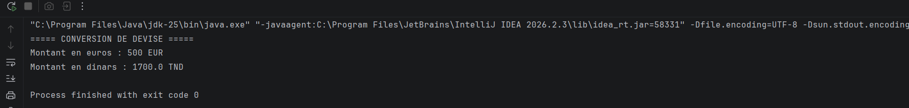

# TP 5 – Activité 5-1 : Service de conversion de devise avec Java RMI

**Faculté des Sciences de Sfax – Département d'informatique et des Communications**
**Matière :** Développement d'Applications Réparties – LSI 3 – Année universitaire 2026-2027
**Étudiant(e) :** *Maymana Amara*

---

## 1. Objectif

Concevoir une application répartie avec **Java RMI** : un serveur expose un service distant de conversion de devise (euro → dinar tunisien) et un client invoque la méthode distante `convertirMontant(double mt)`.

Cycle de vie d'un service distant illustré dans ce TP : **définition de l'interface → implémentation → enregistrement (RMIRegistry) → invocation.**

## 2. Environnement

- JDK 1.8 ou supérieur
- IntelliJ IDEA
- Git / GitHub

## 3. Structure du projet

- **TP5_Activite5_1** (répertoire de travail)
    - **RMIConversion_Server**
        - package `rmiService` : `IConversion`, `ConversionImpl`
        - package `rmiServer` : `ConversionServer`
    - **RMIConversion_Client**
        - package `rmiClient` : `ConversionClient`
    - `conversionClient.jar` (contient uniquement l'interface `IConversion`)
    - `README.md`

## 4. Description des classes

| Classe | Package | Rôle |
|---|---|---|
| `IConversion` | `rmiService` | Interface distante : étend `Remote` et déclare la méthode `convertirMontant(double mt)` qui lève `RemoteException` |
| `ConversionImpl` | `rmiService` | Implémentation du service : étend `UnicastRemoteObject` et convertit un montant en euros en dinars avec un taux de 3,4 |
| `ConversionServer` | `rmiServer` | Active le RMIRegistry sur le port 1099, crée une instance de `ConversionImpl` et publie sa référence dans l'annuaire sous le nom `ConversionService` |
| `ConversionClient` | `rmiClient` | Recherche l'objet distant `ConversionService` dans l'annuaire et invoque `convertirMontant(500)` |

## 5. Étapes de réalisation

### Étape 1 : Préparation de l'espace de travail
Création du répertoire `TP5_Activite5_1`.

### Étape 2 : Développement du serveur
Création du projet `RMIConversion_Server`, du package `rmiService` (interface `IConversion` et classe `ConversionImpl`) et du package `rmiServer` (classe `ConversionServer`).

>  *Capture d'écran : arborescence du projet serveur*
> `

### Étape 3 : Développement du client
1. Création du projet `RMIConversion_Client`.
2. Export du package `rmiService` du serveur en ne sélectionnant que `IConversion` (sans `ConversionImpl`) dans le fichier `conversionClient.jar`.
3. Ajout du jar aux dépendances du projet client (*Project Structure → Modules → Dependencies → JARs or Directories*).
4. Création de la classe `ConversionClient` dans le package `rmiClient`.

### Étape 4 : Exécution
1. Lancer d'abord `ConversionServer` (il doit rester actif).
2. Lancer ensuite `ConversionClient`.

> *Capture d'écran : console du serveur (« Serveur RMI prêt... »)*

>

Résultat obtenu : **500 EUR = 1700.0 TND**

## 5. Synthèse

Ce TP a permis de mettre en œuvre une communication client/serveur avec Java RMI :

- L'**interface distante** `IConversion` définit le contrat partagé entre le client et le serveur. Elle étend `Remote` et ses méthodes déclarent `RemoteException`.
- La classe `ConversionImpl`, qui étend `UnicastRemoteObject`, est exportée automatiquement et devient accessible à distance.
- Le serveur démarre le **RMIRegistry** et y publie la référence de l'objet sous le nom `ConversionService`.
- Le client n'a besoin que de l'interface (fournie via `conversionClient.jar`) : il obtient un **stub** grâce à `Naming.lookup(...)`, puis appelle la méthode comme si l'objet était local. RMI s'occupe de la sérialisation des paramètres et du résultat.

**Difficultés rencontrées et solutions :**

| Problème | Cause | Solution |
|---|---|---|
| `package rmiService does not exist` côté client | Le jar de l'interface n'était pas ajouté au projet client | Génération de `conversionClient.jar` et ajout aux dépendances |
| `NotBoundException` / `NameNotFoundException` | Nom différent entre `rebind` et `lookup` | Utiliser exactement le même nom des deux côtés |
| Erreur de lookup avec `InitialContext` | JNDI non configuré | Utiliser `Naming` avec le RMIRegistry, comme demandé dans l'énoncé |

**Conclusion :** RMI permet d'invoquer des méthodes sur des objets distants de façon transparente. Le service de conversion fonctionne : le client obtient bien le montant converti calculé par le serveur.